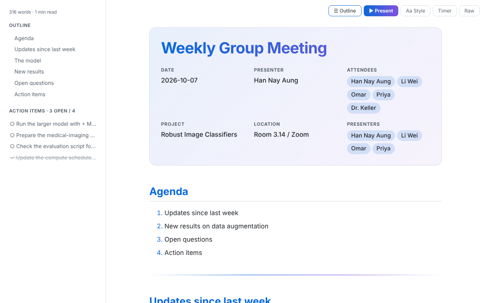

<p align="center"></p>

# Markdown Meeting Viewer

A Firefox add-on for **research group meetings**: read Markdown files as clean
pages, and present them as slides with a talk timer, bells and an automatic
"next presenter" notice.

研究室の**グループミーティング**のための Firefox 拡張機能です。Markdown ファイルを
見やすいページで読み、発表タイマー・鈴・「次の発表者」の自動アナウンス付きの
スライドとして発表できます。

**[English](#english) · [日本語](#日本語)**



---

## English

### Features

- **Reading view**: themes (Auto, Journal, Paper, Midnight, Slate, Sepia, Navy, KG),
  two fonts, text size, page width, numbered headings, outline sidebar, word count.
- **Research writing**: math (`$E=mc^2$`, `$$…$$`), callout boxes
  (`> [!RESULT]`, `> [!QUESTION]` …), footnotes, numbered figures and tables,
  colored code with copy buttons, action items (`- [ ]`) and `@mentions`.
- **Meeting header**: title, date, presenter and attendees from the top of the file.
- **Present mode**: slides from `---` or headings, auto-fit text, full screen.
- **Talk timer**: big clock in the corner, 7:00 by default, counts down,
  turns amber and red, click to pause.
- **Bells**: 1st bell before the end, 2nd bell at the end, 3rd bell after Q&A —
  like Japanese academic conferences (1鈴・2鈴・3鈴). They move with the talk length.
- **Presenter list**: near the end of a talk, a notice in the middle of the slide
  names the next presenter, with a chime and a voice. The built-in voice is
  Japanese; you can use your own audio file instead.
- **Private**: everything runs in your browser. Nothing is collected or sent.

### Install

- Firefox Add-ons: **https://addons.mozilla.org/firefox/addon/markdown-meeting-viewer/**
  *(available after Mozilla's review)*
- To try the code yourself, see [Development](#development).

### How to use

- **Open a file**: open a `.md` file in Firefox, or click the toolbar button and
  drop a file onto the page. *If Firefox downloads `.md` files instead of showing
  them, use the toolbar button.*
- **Buttons** (top right):
  - ☰ **Outline**: headings, open action items, word count
  - ▶ **Present**: start the slides
  - **Aa Style**: theme, font, size, width, numbered headings
  - **Timer**: talk length, bells, presenter list, notice and voice
  - **Raw**: show the original text
- **Print / PDF**: press `Ctrl+P` for a clean black-on-white handout.

### File header (optional)

Put this at the very top of your `.md` file. Every line is optional.

```yaml
---
title: Weekly Group Meeting
date: 2026-10-07
presenter: Alex Kim                     # who starts
presenters: [Alex Kim, Sam Lee, Mia Chen]   # speaking order
attendees: [Alex, Sam, Mia, Dr. Ito]
timer: 7          # talk length in minutes
warning: 2        # 1st bell, minutes before the end ("off" = no bell)
qa: 5             # 3rd bell, minutes of Q&A after the end ("off" = no bell)
announce: 3       # show the next-presenter notice, minutes before the end
announce-audio: next-sam.mp4   # your own recording, in the same folder as the .md
---
```

### Keys in Present mode

| Key | Action |
|---|---|
| → / Space / PageDown | next slide |
| ← / PageUp | previous slide |
| F | full screen |
| P | pause / resume the clock |
| T | restart the clock |
| + / − | one minute more / less |
| N | show the next-presenter notice now |
| ] / [ | next / previous presenter (restarts the clock) |
| S | timer settings |
| Esc | close the notice or panel, then leave |

Try [`examples/example-meeting.md`](examples/example-meeting.md) to see every feature.

### Development

You need [Node.js](https://nodejs.org/) (18 or newer) and Firefox.

```sh
npm install        # once
npm start          # opens Firefox with the add-on loaded; reloads on save
npm run lint       # Mozilla's checks
npm run build      # makes dist/markdown-meeting-viewer-<version>.zip
```

The add-on is plain JavaScript in `src/`, with no build step.
How to release and maintain it: [MAINTAINING.md](MAINTAINING.md).

### Author

Created by **Han Nay Aung**.

**How it was made:** the idea, features, design decisions and testing are by
Han Nay Aung. Most of the code was written with an AI assistant
(Claude, by Anthropic) and checked with Mozilla's add-on linter and browser
tests. Bug reports and ideas are welcome in the Issues tab.

### License

MIT — see [LICENSE](LICENSE). Third-party libraries and voices keep their own
licenses: [THIRD_PARTY.md](THIRD_PARTY.md).
The "KG" theme uses colors from Kwansei Gakuin's public visual identity
guidelines; this project is not affiliated with or endorsed by the university.

---

## 日本語

### 主な機能

- **閲覧**：テーマ（Auto・Journal・Paper・Midnight・Slate・Sepia・Navy・KG）、
  フォント2種、文字サイズ、ページ幅、見出し番号、目次サイドバー、文字数
- **研究向けの書き方**：数式（`$E=mc^2$`、`$$…$$`）、コールアウト
  （`> [!RESULT]`、`> [!QUESTION]` など）、脚注、図・表の番号、
  コードの色分けとコピーボタン、アクションアイテム（`- [ ]`）、`@メンション`
- **ミーティングのヘッダー**：ファイル先頭からタイトル・日付・発表者・参加者を表示
- **発表モード**：`---` または見出しでスライドに分割、文字サイズの自動調整、全画面
- **発表タイマー**：画面の隅に大きな時計。初期値 7:00 のカウントダウン、
  オレンジ・赤に色が変わる、クリックで一時停止
- **鈴**：学会と同じ 1鈴（終了前）・2鈴（終了時）・3鈴（質疑終了）。
  発表時間を変えると鈴の時刻も連動
- **発表者リスト**：発表の終わり近くに、スライド中央で次の発表者をお知らせ
  （チャイムと音声付き）。内蔵の音声は日本語です。自分の音声ファイルも使えます
- **プライバシー**：すべてブラウザ内で動作し、データの収集・送信はありません

### インストール

- Firefox アドオン：**https://addons.mozilla.org/firefox/addon/markdown-meeting-viewer/**
  （Mozilla の審査後に利用できます）
- コードから試す場合は、下の「開発」を見てください。

### 使い方

- **ファイルを開く**：`.md` ファイルを Firefox で開くか、ツールバーのボタンを押して
  ページにファイルをドロップします。*`.md` が表示されずにダウンロードされる場合は、
  ツールバーのボタンを使ってください。*
- **右上のボタン**：
  - ☰ **Outline**：見出し、未完了のアクションアイテム、文字数
  - ▶ **Present**：スライドを開始
  - **Aa Style**：テーマ、フォント、サイズ、幅、見出し番号
  - **Timer**：発表時間、鈴、発表者リスト、お知らせと音声
  - **Raw**：元のテキストを表示
- **印刷・PDF**：`Ctrl+P` で白黒のきれいな配布資料になります。

### ファイルのヘッダー（任意）

`.md` ファイルの一番上に書きます。どの行も省略できます。

```yaml
---
title: 週次ミーティング
date: 2026-10-07
presenter: 山田 太郎                       # 最初の発表者
presenters: [山田 太郎, 佐藤 花子, 鈴木 一郎]   # 発表順
attendees: [山田, 佐藤, 鈴木, 伊藤 先生]
timer: 7          # 発表時間（分）
warning: 2        # 1鈴：終了の何分前か（"off" で鳴らさない）
qa: 5             # 3鈴：終了後の質疑の時間（分）（"off" で鳴らさない）
announce: 3       # 次の発表者のお知らせ：終了の何分前か
announce-audio: next-sato.mp4   # 自分で録音した音声（.md と同じフォルダに置く）
---
```

### 発表モードのキー操作

| キー | 動作 |
|---|---|
| → / スペース / PageDown | 次のスライド |
| ← / PageUp | 前のスライド |
| F | 全画面 |
| P | 時計の一時停止・再開 |
| T | 時計を最初から |
| + / − | 発表時間を1分増やす・減らす |
| N | 次の発表者のお知らせを今すぐ表示 |
| ] / [ | 次・前の発表者へ（時計も最初から） |
| S | タイマーの設定 |
| Esc | お知らせ・設定を閉じる、もう一度で発表モード終了 |

すべての機能は [`examples/example-meeting.md`](examples/example-meeting.md) で試せます。

### 開発

[Node.js](https://nodejs.org/)（18 以上）と Firefox が必要です。

```sh
npm install        # 最初の1回だけ
npm start          # 拡張機能を入れた Firefox が開き、保存すると自動で再読み込み
npm run lint       # Mozilla のチェック
npm run build      # dist/markdown-meeting-viewer-<バージョン>.zip を作成
```

拡張機能は `src/` の中の普通の JavaScript で、ビルド作業は不要です。
公開・更新の手順は [MAINTAINING.md](MAINTAINING.md) にあります。

### 作者

**Han Nay Aung** が作成しました。

**作り方について：** アイデア、機能、デザインの判断、テストは Han Nay Aung によるものです。
コードの大部分は AI アシスタント（Anthropic の Claude）を使って書かれ、
Mozilla のチェックツールとブラウザでのテストで確認しています。
不具合の報告やアイデアは Issues タブへどうぞ。

### ライセンス

MIT ライセンスです（[LICENSE](LICENSE)）。ライブラリと音声は、それぞれのライセンスに
従います（[THIRD_PARTY.md](THIRD_PARTY.md)）。
「KG」テーマは関西学院の公開 VI ガイドラインの色を使っていますが、大学とは関係のない
非公式のテーマです。
